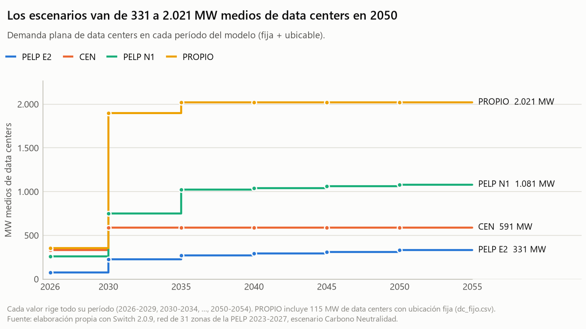
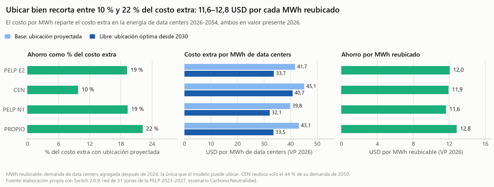
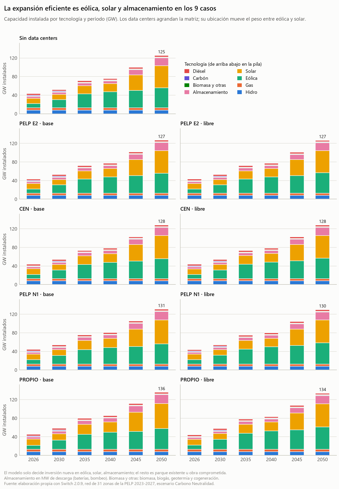
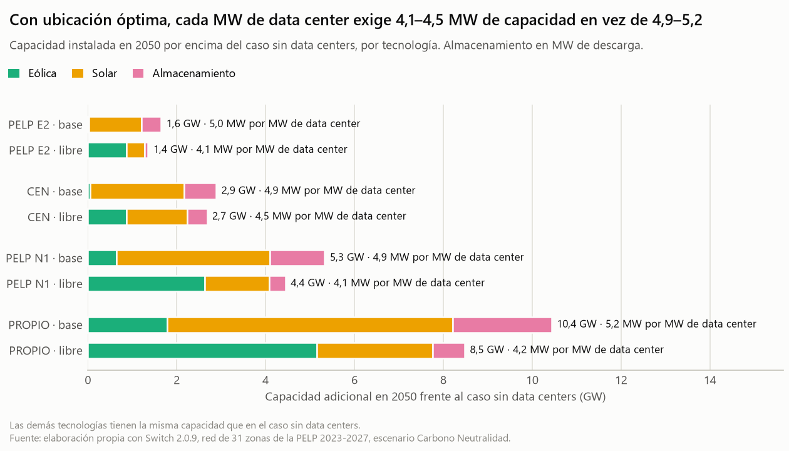
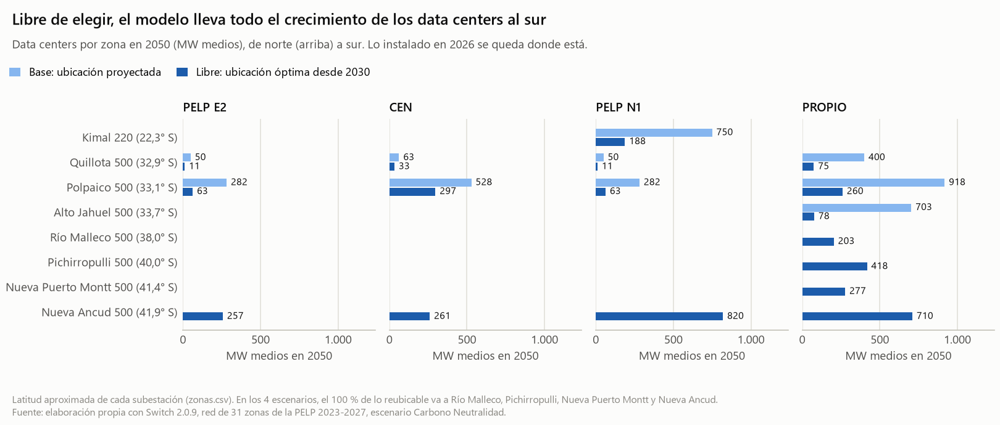
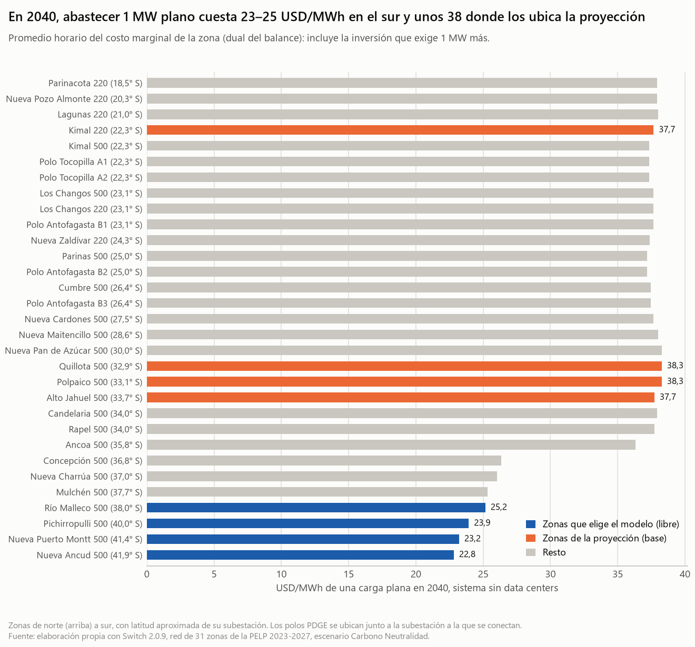

# Análisis de resultados

¿Cuánto se ahorra en la planificación del SEN si el modelo elige dónde van los data centers, frente a ubicarlos donde dicen las proyecciones? Switch 2.0.9 sobre la red de 31 zonas de la PELP 2023–2027 (Carbono Neutralidad), 6 períodos (2026–2054) y 6 días típicos de 24 horas. Costos en valor presente (VP) a 2026 con tasa de 6 %, en millones de USD (MMUSD).

Cada cifra sale de una tabla de `resultados/tablas/`, indicada en cada sección. El modelo está en [FORMULACION.md](FORMULACION.md) y las entradas en [DATOS_Y_SUPUESTOS.md](DATOS_Y_SUPUESTOS.md).

**Casos.** `SIN_DC` es Carbono Neutralidad sin data centers proyectados. Cada uno de los 4 escenarios de data centers se resuelve dos veces:

- **Base:** los data centers en las zonas que indica la proyección.
- **Libre:** los mismos MW en los mismos períodos; el modelo elige la zona de lo que se agrega desde 2030 entre las 26 barras candidatas. Lo del período 2026 queda en su zona proyectada y un data center no se traslada.

**Definiciones.** *Costo extra* = costo del caso − costo de `SIN_DC`. *Ahorro* = costo base − costo libre. *Reubicable* = la demanda que se agrega después de 2026, la única que el caso libre puede mover.

---

## 1. Resumen de hallazgos

1. **Ubicar bien ahorra 211, 275, 708 y 1.783 MMUSD** en PELP E2, CEN, PELP N1 y PROPIO. Es entre el 9,8 % y el 22,2 % del costo extra que agregan los data centers, y entre el 0,51 % y el 3,67 % del costo total del sistema.
2. **El ahorro por MWh reubicado es casi el mismo en los 4 escenarios: 11,6 a 12,8 USD/MWh.** CEN ahorra menos en proporción (9,8 %) porque solo el 44 % de su demanda de 2050 es reubicable; en los demás, entre 76 % y 80 %.
3. **Todo lo reubicable va al sur:** a Nueva Ancud en los 4 escenarios y, en PROPIO, también a Nueva Puerto Montt, Pichirropulli y Río Malleco. En 2040, sin data centers, abastecer 1 MW plano cuesta 22,8–25,2 USD/MWh en el sur y 37,7–38,3 USD/MWh en las zonas proyectadas. El sur exporta el 65 % de lo que genera, y los corredores Ancoa–Nueva Charrúa y Mulchén–Río Malleco llegan a su tope de ampliación en los 9 casos.
4. **Con la ubicación óptima se construye más eólica (+0,8 a +3,4 GW), menos solar FV (−0,7 a −3,8 GW), menos bombeo y entre 1,3 y 4,6 GW menos de transmisión.** Cada MW de data center pide 4,1–4,5 MW de capacidad nueva en vez de 4,9–5,2. Entre el 76 % y el 88 % del ahorro es menor inversión en generación y almacenamiento y menos combustible.
5. **La matriz eficiente es eólica, solar y almacenamiento en todos los casos.** Sin data centers, en 2050 hay 42,9 GW eólicos, 47,6 GW solares y 16,9 GW de almacenamiento; eólica y solar dan el 91,9 % de la generación y las renovables el 98,3 %. El modelo solo decide invertir en eólica, solar FV, baterías y bombeo.
6. **La ubicación óptima baja las emisiones acumuladas 2026–2054 entre 1,7 y 3,7 Mt CO₂.** No cambia el vertimiento, salvo en PROPIO (−17,8 TWh acumulados).
7. **Cada corrida tarda entre 8,1 y 15,6 minutos;** entre el 62 % y el 73 % es el presolve y la barrera de Gurobi.

---

## 2. Escenarios de data centers

Demanda de data centers que se agrega al modelo, en MW medios: carga plana, el mismo valor en todas las horas de cada período. Los data centers que ya operan están dentro de la demanda de la PELP y no se agregan. El origen de cada escenario está en [DATOS_Y_SUPUESTOS.md, sección 8](DATOS_Y_SUPUESTOS.md#8-data-centers).

| Escenario | Fuente | Zonas de la proyección |
|---|---|---|
| PELP E2 | PELP 2028–2032, escenario E2 | Polpaico 500, Quillota 500 |
| CEN | Proyección de Demanda 2026–2046 del Coordinador | Polpaico 500, Quillota 500 |
| PELP N1 | PELP 2028–2032, escenario N1 | Polpaico 500, Quillota 500, Kimal 220 |
| PROPIO | Solicitudes de conexión vigentes ante el Coordinador | Polpaico 500, Alto Jahuel 500, Quillota 500 |

| Escenario | 2026 | 2030 | 2035 | 2050 | GWh/año en 2050 | Reubicable en 2050 |
| --- | ---: | ---: | ---: | ---: | ---: | ---: |
| PELP E2 | 74 | 225 | 273 | 331 | 2.904 | 257 MW (78 %) |
| CEN | 330 | 591 | 591 | 591 | 5.177 | 261 MW (44 %) |
| PELP N1 | 262 | 750 | 1.023 | 1.081 | 9.474 | 820 MW (76 %) |
| PROPIO | 355 | 1.899 | 2.021 | 2.021 | 17.701 | 1.608 MW (80 %) |

Tablas: `escenarios_dc.csv`, `escenarios_dc_resumen.csv`. PROPIO incluye 115 MW medios fijos desde 2030 (llenado de campus ya conectados en Polpaico y Alto Jahuel), que no se mueven en ningún caso.



CEN concentra su crecimiento en el período 2026: 330 de sus 591 MW quedan comprometidos en Polpaico y Quillota. Por eso es el escenario con menos demanda reubicable.

---

## 3. Costo extra y ahorro

El sistema sin data centers cuesta **40.538 MMUSD**.

| Escenario | Costo base | Costo libre | Extra base | Extra libre | Ahorro | Ahorro / extra | Ahorro / total |
| --- | ---: | ---: | ---: | ---: | ---: | ---: | ---: |
| PELP E2 | 41.638 | 41.427 | 1.100 | 889 | 211 | 19,2 % | 0,51 % |
| CEN | 43.354 | 43.079 | 2.816 | 2.541 | 275 | 9,8 % | 0,64 % |
| PELP N1 | 44.198 | 43.490 | 3.660 | 2.952 | 708 | 19,3 % | 1,60 % |
| PROPIO | 48.573 | 46.790 | 8.034 | 6.252 | 1.783 | 22,2 % | 3,67 % |


Por MWh, con la energía también en VP 2026:

| Escenario | Energía DC (TWh VP) | Extra base (USD/MWh) | Extra libre (USD/MWh) | Energía reubicable (TWh VP) | Ahorro por MWh DC | Ahorro por MWh reubicado |
| --- | ---: | ---: | ---: | ---: | ---: | ---: |
| PELP E2 | 26,4 | 41,7 | 33,7 | 17,5 | 8,0 | 12,0 |
| CEN | 62,5 | 45,1 | 40,7 | 23,1 | 4,4 | 11,9 |
| PELP N1 | 92,0 | 39,8 | 32,1 | 60,9 | 7,7 | 11,6 |
| PROPIO | 186,5 | 43,1 | 33,5 | 139,1 | 9,6 | 12,8 |

Tablas: `costos.csv`, `escenarios_dc_resumen.csv`.



- **Abastecer un data center cuesta al sistema 40–45 USD/MWh con la ubicación proyectada** y 32–41 USD/MWh con la óptima.
- **El ahorro escala con lo que se puede mover.** Por MWh reubicado es de 11,6 a 12,8 USD/MWh en los 4 escenarios, aunque su demanda va de 331 a 2.021 MW. Las diferencias en el ahorro relativo vienen sobre todo de la parte comprometida en 2026.
- **Es también un umbral.** Ubicar un data center en el sur conviene al sistema mientras lo que cuesta llevarlo allá (conexión, terreno, fibra, latencia), que el modelo no incluye, sea menor que unos 12 USD por MWh consumido.

---

## 4. De dónde sale el ahorro

Ahorro (base − libre) por componente del costo total, en MMUSD y en % del ahorro:

| Componente | PELP E2 | CEN | PELP N1 | PROPIO |
| --- | ---: | ---: | ---: | ---: |
| Inversión y O&M fijo de generación y almacenamiento | 89,3 (42 %) | 91,1 (33 %) | 378,1 (53 %) | 1.435,1 (80 %) |
| Combustible | 72,7 (34 %) | 117,0 (42 %) | 205,3 (29 %) | 129,3 (7 %) |
| Transmisión (inversión y O&M fijo) | 25,8 (12 %) | 34,5 (13 %) | 65,6 (9 %) | 139,3 (8 %) |
| Impuesto al CO₂ | 19,9 (9 %) | 23,7 (9 %) | 38,4 (5 %) | 58,7 (3 %) |
| O&M variable | 3,6 (2 %) | 9,2 (3 %) | 20,3 (3 %) | 20,6 (1 %) |
| **Total** | **211,3** | **275,4** | **707,6** | **1.782,9** |

Tabla: `costos_por_componente.csv` (columnas `base - libre`). No hay energía no suministrada en ningún caso.


- **Inversión en generación y almacenamiento:** es la mayor parte del ahorro en PROPIO (80 %) y PELP N1 (53 %), los escenarios con más carga reubicable. Es también la mayor parte del costo extra: entre 65 % y 83 % con la ubicación proyectada.
- **Combustible:** pesa más donde la carga reubicable es menor (42 % en CEN, 34 % en PELP E2).
- **Transmisión:** entre 8 % y 13 % del ahorro, aunque su costo extra con la ubicación proyectada es solo el 2–3 % del costo extra total.

---

## 5. Expansión eficiente

### 5.1 Matriz de capacidad y generación

Capacidad instalada sin data centers, en GW, y participación en la generación de 2050:

| Familia (GW) | 2026 | 2030 | 2035 | 2040 | 2045 | 2050 | Generación 2050 |
| --- | ---: | ---: | ---: | ---: | ---: | ---: | ---: |
| Hidro | 7,9 | 7,9 | 7,9 | 7,9 | 7,9 | 7,9 | 5,4 % |
| Gas | 4,9 | 4,9 | 4,9 | 4,9 | 4,9 | 4,9 | 1,2 % |
| Eólica | 9,0 | 17,5 | 29,8 | 34,3 | 37,5 | 42,9 | 49,4 % |
| Solar | 11,5 | 11,5 | 17,5 | 17,5 | 33,3 | 47,6 | 42,6 % |
| Almacenamiento | 4,1 | 4,4 | 5,8 | 6,2 | 11,0 | 16,9 | – |
| Biomasa y otras | 1,0 | 1,0 | 1,0 | 1,0 | 1,0 | 1,0 | 1,0 % |
| Carbón | 1,6 | 1,6 | 0,7 | 0,7 | 0,7 | 0,7 | 0,2 % |
| Diésel | 3,3 | 3,3 | 3,3 | 3,3 | 3,3 | 3,3 | 0,1 % |
| **Total** | **43,2** | **52,1** | **70,8** | **75,7** | **99,6** | **125,3** | 100 % |

Tabla: `matriz_generacion.csv` (por grupo de tecnología, en los 9 casos). Solar incluye 0,1 GW de CSP; biomasa y otras incluye biogás, geotermia y cogeneración; el carbón que queda desde 2035 es co-combustión con amoníaco. La participación excluye la descarga del almacenamiento.

- La generación sin data centers pasa de 100.929 GWh en 2026 a 278.159 GWh en 2050.
- La eólica es la primera fuente desde 2030 (57,5 % ese año) y la solar crece sobre todo en 2045–2050.
- En 2050 el almacenamiento tiene 40,6 GWh en baterías y 75,7 GWh en bombeo.



Capacidad adicional en 2050 frente a `SIN_DC`, en GW. Las demás tecnologías no cambian:

| Caso | Eólica | Solar | Almacenamiento | Total | MW por MW de DC |
| --- | ---: | ---: | ---: | ---: | ---: |
| PELP E2 · base | 0,02 | 1,19 | 0,44 | 1,65 | 5,0 |
| PELP E2 · libre | 0,87 | 0,40 | 0,08 | 1,35 | 4,1 |
| CEN · base | 0,05 | 2,12 | 0,72 | 2,89 | 4,9 |
| CEN · libre | 0,86 | 1,37 | 0,44 | 2,68 | 4,5 |
| PELP N1 · base | 0,65 | 3,45 | 1,24 | 5,33 | 4,9 |
| PELP N1 · libre | 2,63 | 1,44 | 0,37 | 4,45 | 4,1 |
| PROPIO · base | 1,79 | 6,42 | 2,23 | 10,44 | 5,2 |
| PROPIO · libre | 5,16 | 2,60 | 0,72 | 8,48 | 4,2 |



Con la ubicación proyectada, los data centers se abastecen sobre todo con solar y almacenamiento. Con la óptima, con eólica nueva, toda en el centro-sur y el sur (`expansion_por_zona.csv`), y bastante menos almacenamiento.

### 5.2 Inversiones nuevas por tecnología

MW construidos entre 2026 y 2050 sin data centers. Comprometidos son las obras fijas en las entradas:

| Grupo | MW construidos | Comprometidos | Decididos por el modelo | MWh de almacenamiento |
| --- | ---: | ---: | ---: | ---: |
| Baterías | 7.775 | 2.171 | 5.604 | 32.557 |
| Biomasa y biogás | 200 | 200 | 0 | 0 |
| Bombeo | 7.236 | 0 | 7.236 | 75.700 |
| Carbón con co-combustión de amoníaco | 2.379 | 2.379 | 0 | 0 |
| Eólica | 37.980 | 0 | 37.980 | 0 |
| Gas ciclo abierto y motores | 300 | 300 | 0 | 0 |
| Solar FV | 39.810 | 0 | 39.810 | 0 |

Los MW construidos incluyen reposiciones dentro del horizonte (las baterías nuevas duran 15 años). En los 9 casos, el modelo solo decide invertir en eólica, solar FV, baterías y bombeo.

Diferencia de MW construidos 2026–2050, libre − base:

| Grupo | PELP E2 | CEN | PELP N1 | PROPIO |
| --- | ---: | ---: | ---: | ---: |
| Eólica | +854 | +817 | +1.988 | +3.371 |
| Solar FV | −788 | −749 | −2.005 | −3.818 |
| Baterías | −208 | +12 | −174 | −246 |
| Bombeo | −150 | −287 | −690 | −1.264 |

Tablas: `inversiones_por_tecnologia.csv`, `inversiones_libre_menos_base.csv` (con la diferencia por período).


La sustitución de solar por eólica empieza en el período 2026, aunque la ubicación de ese período es la misma en ambos modos: el caso libre construye entre 79 y 1.063 MW menos de solar FV en 2026, porque anticipa que la carga de 2030 en adelante irá al sur.

### 5.3 Transmisión

MW agregados a los corredores entre 2026 y 2050 (incluye las obras comprometidas) e inversión overnight, sin descontar, en MMUSD:

| Escenario | Ampliado base (GW) | Ampliado libre (GW) | Libre − base (GW) | Inversión base | Inversión libre | Libre − base |
| --- | ---: | ---: | ---: | ---: | ---: | ---: |
| PELP E2 | 78,6 | 76,2 | −2,4 | 5.717 | 5.584 | −133 |
| CEN | 80,3 | 79,1 | −1,3 | 5.831 | 5.730 | −101 |
| PELP N1 | 80,2 | 78,5 | −1,6 | 5.816 | 5.670 | −145 |
| PROPIO | 87,2 | 82,6 | −4,6 | 6.294 | 5.952 | −342 |

Sin data centers se amplían 75,8 GW. Las obras comprometidas son 2.660 MW: el HVDC Kimal–Lo Aguirre (2.000 MW, corredor Kimal 500 – Alto Jahuel 500) y Río Malleco–Pichirropulli (660 MW), ambas en 2030.

| Escenario | Mayores reducciones (MW) | Mayores aumentos (MW) |
| --- | --- | --- |
| PELP E2 | Nueva Pozo Almonte 220 – Lagunas 220 (−538); Lagunas 220 – Kimal 220 (−374); Kimal 500 – Los Changos 500 (−259) | Los Changos 500 – Parinas 500 (+155); Concepción 500 – Nueva Charrúa 500 (+23) |
| CEN | Kimal 220 – Nueva Zaldívar 220 (−241); Kimal 500 – Los Changos 500 (−185); Pichirropulli 500 – Nueva Puerto Montt 500 (−169) | Nueva Cardones 500 – Nueva Maitencillo 500 (+166); Los Changos 500 – Parinas 500 (+139) |
| PELP N1 | Lagunas 220 – Kimal 220 (−568); Pichirropulli 500 – Nueva Puerto Montt 500 (−556); Río Malleco 500 – Pichirropulli 500 (−534) | Nueva Pozo Almonte 220 – Lagunas 220 (+505); Kimal 220 – Nueva Zaldívar 220 (+404) |
| PROPIO | Lagunas 220 – Kimal 220 (−797); Río Malleco 500 – Pichirropulli 500 (−747); Los Changos 500 – Los Changos 220 (−726) | Nueva Pozo Almonte 220 – Lagunas 220 (+354); Polpaico 500 – Alto Jahuel 500 (+306) |

Tablas: `transmision_ampliaciones.csv` (por corredor y período), `transmision_libre_menos_base.csv` (totales, tope y diferencia por período).


- **Menos transmisión en los dos extremos.** Con la carga en el sur, ya no hay que llevar tanta energía solar del norte grande al centro ni tanta eólica del sur al centro.
- **Tres corredores llegan a su tope de ampliación, 4.500 MW, en los 9 casos:** Ancoa 500 – Nueva Charrúa 500, Mulchén 500 – Río Malleco 500 y Los Changos 220 – Nueva Zaldívar 220. En PROPIO base llegan al tope además Cumbre 500 – Nueva Cardones 500 y Nueva Charrúa 500 – Mulchén 500.
- **En dinero:** la inversión overnight en transmisión baja entre 101 y 342 MMUSD; en VP, la transmisión explica entre 25,8 y 139,3 MMUSD del ahorro (sección 4).

### 5.4 Expansión por zona

MW nuevos 2026–2050 (generación y almacenamiento) por macrozona sin data centers, en GW, y diferencia libre − base:

| Macrozona | Sin DC (GW nuevos) | PELP E2 | CEN | PELP N1 | PROPIO |
| --- | ---: | ---: | ---: | ---: | ---: |
| Norte Grande | 52,6 | −1,49 | −0,94 | −3,85 | −5,12 |
| Norte Chico | 14,4 | +0,34 | +0,04 | +1,11 | +0,08 |
| Centro | 5,0 | 0,00 | −0,12 | −0,13 | −0,29 |
| Centro-Sur | 11,4 | +0,67 | +0,70 | +1,62 | +1,92 |
| Sur | 12,4 | +0,18 | +0,12 | +0,37 | +1,45 |

Tablas: `expansion_por_zona.csv` (por zona, período y tecnología), `expansion_zona_libre_menos_base.csv` (por zona), `expansion_por_macrozona.csv`.

- **El norte grande concentra la expansión:** 52,6 de los 95,7 GW nuevos sin data centers, con solar, eólica y almacenamiento.
- **Con la ubicación óptima, la expansión se mueve del norte grande al centro-sur y al sur.** Toda la capacidad nueva del sur es eólica: 12,4 GW sin data centers y 14,0 GW en PROPIO libre.
- **Zonas que más cambian, libre − base.** En PROPIO, Lagunas 220 pierde 3.015 MW de generación y 735 MW de almacenamiento; Nueva Cardones 500 gana 1.979 y 796 MW.

**Orden norte → sur.** Las entradas no traen coordenadas. Cada zona es una subestación del SEN, y `zonas.csv` le asigna la latitud aproximada de esa subestación (redondeada a 0,1°), su región y una macrozona: Norte Grande (Arica a Antofagasta), Norte Chico (Atacama y Coquimbo), Centro (Valparaíso, Metropolitana y O'Higgins), Centro-Sur (Maule a Biobío) y Sur (Araucanía a Los Lagos). Los 5 polos PDGE se ubican junto a la subestación a la que se conectan en `transmission_lines.csv`. Cada corredor se ordena por la posición media de sus dos zonas.

---

## 6. Ubicación y precios

Data centers por zona en 2050, en MW medios:

| Zona | PELP E2 base | PELP E2 libre | CEN base | CEN libre | PELP N1 base | PELP N1 libre | PROPIO base | PROPIO libre |
| --- | ---: | ---: | ---: | ---: | ---: | ---: | ---: | ---: |
| Kimal 220 (22,3° S) |  |  |  |  | 750 | 188 |  |  |
| Quillota 500 (32,9° S) | 50 | 11 | 63 | 33 | 50 | 11 | 400 | 75 |
| Polpaico 500 (33,1° S) | 282 | 63 | 528 | 297 | 282 | 63 | 918 | 260 |
| Alto Jahuel 500 (33,7° S) |  |  |  |  |  |  | 703 | 78 |
| Río Malleco 500 (38,0° S) |  |  |  |  |  |  |  | 203 |
| Pichirropulli 500 (40,0° S) |  |  |  |  |  |  |  | 418 |
| Nueva Puerto Montt 500 (41,4° S) |  |  |  |  |  |  |  | 277 |
| Nueva Ancud 500 (41,9° S) |  | 257 |  | 261 |  | 820 |  | 710 |

Tabla: `ubicacion_dc.csv`. En el caso libre, lo que queda en Polpaico, Quillota, Alto Jahuel y Kimal es lo del período 2026 (más la carga fija de PROPIO); el 100 % de lo reubicable va a las 4 zonas del sur.



**Por qué el sur.** El precio de una carga plana es el promedio horario del costo marginal de la zona, el dual de su balance. Como el modelo es de expansión, incluye la inversión que exige abastecer 1 MW más. Sin data centers, en USD/MWh:

| Macrozona | 2030 | 2035 | 2040 | 2045 | 2050 |
| --- | ---: | ---: | ---: | ---: | ---: |
| Norte Grande | 27,5–32,2 | 38,9–40,6 | 37,2–38,0 | 39,1–39,9 | 35,5–36,4 |
| Norte Chico | 32,2–32,2 | 40,1–41,0 | 37,4–38,3 | 40,0–41,3 | 36,2–37,5 |
| Centro | 32,2–32,2 | 41,1–41,1 | 37,7–38,3 | 41,9–42,3 | 38,3–38,5 |
| Centro-Sur | 26,3–31,2 | 32,8–40,1 | 25,3–36,3 | 25,2–41,4 | 30,7–37,2 |
| Sur | 26,3–26,3 | 30,5–32,6 | 22,8–25,2 | 22,4–25,0 | 27,5–29,4 |

Tabla: `precios_zonales.csv` (por zona, período y caso).



Balance de energía por macrozona sin data centers, en 2040:

| Macrozona | Generación neta (TWh) | Demanda (TWh) | Exportación neta (TWh) | Exporta (% de su generación) |
| --- | ---: | ---: | ---: | ---: |
| Norte Grande | 81,5 | 67,5 | +14,0 | 17 % |
| Norte Chico | 15,5 | 19,3 | −3,8 | – |
| Centro | 11,1 | 61,9 | −50,7 | – |
| Centro-Sur | 45,4 | 23,2 | +22,1 | 49 % |
| Sur | 28,3 | 9,9 | +18,4 | 65 % |

Tabla: `balance_por_macrozona.csv`. Generación neta = inyección − carga del almacenamiento.

- **El sur tiene eólica de sobra y no puede exportar más.** Exporta el 65 % de lo que genera, y los corredores hacia el centro (Mulchén – Río Malleco y Ancoa – Nueva Charrúa) están en su tope de ampliación. El precio salta de 26,0 USD/MWh en Nueva Charrúa a 36,3 USD/MWh en Ancoa (2040), a ambos lados de ese tope.
- **Un data center en el sur consume esa energía donde se produce:** no necesita la solar y el almacenamiento del norte ni la transmisión hacia el centro. En PROPIO, la exportación neta del sur en 2040 baja de 24,1 TWh (base) a 13,2 TWh (libre).
- **Nueva Ancud es la zona más barata** (22,8 USD/MWh en 2040). En PROPIO, la carga que recibe sube su precio (25,2 USD/MWh en 2040, caso libre) y el modelo reparte el resto entre Nueva Puerto Montt, Pichirropulli y Río Malleco.

Precio medio de una carga plana en las zonas donde están los data centers, ponderado por sus MW, en USD/MWh:

| Escenario | Base 2030 | Libre 2030 | Base 2040 | Libre 2040 | Base 2050 | Libre 2050 |
| --- | ---: | ---: | ---: | ---: | ---: | ---: |
| PELP E2 | 33,0 | 28,7 | 39,1 | 27,1 | 39,0 | 30,3 |
| CEN | 35,0 | 31,1 | 39,6 | 32,1 | 39,4 | 34,1 |
| PELP N1 | 35,9 | 30,3 | 39,2 | 27,3 | 38,3 | 30,7 |
| PROPIO | 44,7 | 33,9 | 42,2 | 28,9 | 41,2 | 31,9 |

Tabla: `precio_dc.csv` (incluye el precio de las mismas zonas sin data centers).

---

## 7. Emisiones y vertimiento

| Caso | Emisiones 2026–2054 (Mt CO₂) | 2026 (Mt/año) | 2030 (Mt/año) | 2050 (Mt/año) | Renovable 2050 | Vertimiento solar y eólico 2050 | Vertimiento acumulado (TWh) |
| --- | ---: | ---: | ---: | ---: | ---: | ---: | ---: |
| Sin data centers | 120,3 | 13,74 | 2,02 | 2,35 | 98,3 % | 5,8 % | 221,1 |
| PELP E2 · base | 123,7 | 13,99 | 2,35 | 2,33 | 98,3 % | 5,8 % | 232,6 |
| PELP E2 · libre | 122,0 | 14,11 | 2,16 | 2,35 | 98,3 % | 5,9 % | 232,6 |
| CEN · base | 132,0 | 15,43 | 2,55 | 2,34 | 98,4 % | 5,8 % | 238,7 |
| CEN · libre | 129,9 | 15,50 | 2,41 | 2,31 | 98,4 % | 5,9 % | 241,4 |
| PELP N1 · base | 129,2 | 14,21 | 2,84 | 2,31 | 98,4 % | 5,9 % | 250,7 |
| PELP N1 · libre | 125,5 | 14,33 | 2,44 | 2,32 | 98,4 % | 6,1 % | 250,7 |
| PROPIO · base | 136,4 | 14,35 | 3,57 | 2,28 | 98,5 % | 6,3 % | 288,1 |
| PROPIO · libre | 132,9 | 15,23 | 2,83 | 2,31 | 98,5 % | 6,3 % | 270,3 |

Tablas: `emisiones_vertimiento.csv` (por período), `resumen_casos.csv`. Emisiones acumuladas = emisiones anuales × años de cada período. Vertimiento = energía disponible (capacidad × disponibilidad × factor de planta horario, el mismo límite de despacho de Switch) − energía despachada.

- **Emisiones.** El período 2026–2029 emite 13,7–15,5 Mt/año y aporta entre el 42 % y el 48 % de las acumuladas; desde 2030 quedan entre 2,0 y 3,7 Mt/año. La ubicación óptima baja las acumuladas en 1,7 (PELP E2), 2,1 (CEN), 3,7 (PELP N1) y 3,5 Mt (PROPIO). En 2026 el caso libre emite algo más: construye menos solar en ese período (sección 5.2).
- **CEN emite más que PELP N1** (132,0 frente a 129,2 Mt con ubicación proyectada) aunque tiene menos demanda en 2050. La diferencia está en 2026–2029 (15,43 frente a 14,21 Mt/año), cuando CEN ya tiene 330 MW, todos en el centro, y PELP N1 262 MW.
- **Vertimiento.** El de solar y eólica es de 5,8–6,3 % en 2050 en todos los casos y la ubicación casi no lo cambia, salvo en PROPIO (−17,8 TWh acumulados). El vertimiento hídrico no supera 94,5 GWh/año.

---

## 8. Tiempos de cómputo

| Caso | Hilos | Lectura y construcción (s) | Iteraciones de barrera | Barrera (s) | Crossover (s) | Solver según Switch (s) | Posproceso (s) | Reloj (min) |
| --- | ---: | ---: | ---: | ---: | ---: | ---: | ---: | ---: |
| Sin data centers | 4 | 45 | 152 | 532 | 17 | 723 | 43 | 13,7 |
| PELP E2 · base | 6 | 24 | 168 | 561 | 27 | 692 | 51 | 13,0 |
| PELP E2 · libre | 5 | 23 | 161 | 623 | 51 | 778 | 65 | 14,7 |
| CEN · base | 6 | 24 | 164 | 575 | 29 | 706 | 52 | 13,3 |
| CEN · libre | 5 | 23 | 181 | 686 | 52 | 837 | 59 | 15,6 |
| PELP N1 · base | 6 | 24 | 147 | 504 | 58 | 667 | 51 | 12,6 |
| PELP N1 · libre | 5 | 23 | 151 | 655 | 54 | 810 | 64 | 15,2 |
| PROPIO · base | 8 | 20 | 146 | 307 | 17 | 411 | 46 | 8,1 |
| PROPIO · libre | 8 | 20 | 154 | 301 | 20 | 409 | 46 | 8,1 |

Tablas: `tiempos_computo.csv`, `entorno_computo.csv`.


- **Tamaño.** Cada caso es un programa lineal de 1.352.985 restricciones, 1.181.542 variables y 6.919.914 coeficientes; tras el presolve quedan unas 781 mil filas y 877 mil columnas.
- **Equipo y solver.** Intel Core Ultra 9 185H (16 núcleos físicos, 22 lógicos), Gurobi 13.0.3 con barrera (`Method=2`).
- **Dónde se va el tiempo.** El presolve y la barrera de Gurobi son entre el 62 % y el 73 % del tiempo de reloj. Pasar el modelo de Pyomo a Gurobi y leer la solución toma otros 87 a 173 s.
- **Las 9 corridas suman 114,3 minutos.** Se lanzaron en lotes, varias a la vez y con 4 a 8 hilos cada una, así que el tiempo de reloj no es comparable entre lotes: PROPIO, con 8 hilos, tardó 8,1 min.

---

## 9. Limitaciones

Las del modelo y los datos están en [DATOS_Y_SUPUESTOS.md, sección 9](DATOS_Y_SUPUESTOS.md#9-limitaciones). Las que más pesan en estos resultados:

- **Sin costos de ubicación de los data centers.** El caso libre no paga conexión, terreno, fibra ni latencia, ni tiene tope por zona. El ahorro es el del sistema eléctrico; los 11,6–12,8 USD por MWh reubicado son el máximo que esos costos podrían sumar para que reubicar siga conviniendo.
- **El sur barato depende de dos topes de transmisión** (Ancoa – Nueva Charrúa y Mulchén – Río Malleco), que vienen de los candidatos de la PELP. Si esos corredores pudieran ampliarse más, la diferencia de precio entre el sur y el centro, y con ella el ahorro, sería menor.
- **Modelo de transporte.** Sin leyes de Kirchhoff ni pérdidas, abastecer el centro desde el norte sale más barato de lo que es: por este lado, el ahorro está subestimado.
- **Una sola zona de destino.** Nueva Ancud gana a Nueva Puerto Montt por ~1 % ([VALIDACION.md](VALIDACION.md#6-resultados)): el resultado se lee como «zona de Los Lagos», no como una subestación. La carga en Chiloé depende además de ampliar un enlace radial sin criterio N−1.
- **Previsión perfecta y carga plana.** El caso libre elige la zona con los precios futuros que el propio modelo produce, y los data centers no tienen flexibilidad horaria.
- **6 días típicos por período** y operación sin compromiso de unidades.
- **Latitudes aproximadas.** El orden norte → sur de `zonas.csv` es una aproximación propia; cambiar un decimal no altera el orden por macrozona.
- **PROPIO con carga fija** no tiene la verificación independiente de costos que tuvieron los otros escenarios ([VALIDACION.md, sección 8](VALIDACION.md#8-lo-que-no-está-validado)).

---

## Reproducción

Desde la raíz del repositorio, con las salidas ya incluidas (no hace falta volver a resolver):

```bash
python scripts/resultados.py
python scripts/tiempos_computo.py
python scripts/analisis.py
python scripts/graficos.py
```

`graficos.py` lee las tablas de los tres primeros, incluida `tiempos_computo.csv`. Las figuras quedan en `resultados/figuras/` en PNG (150 dpi) y SVG.
