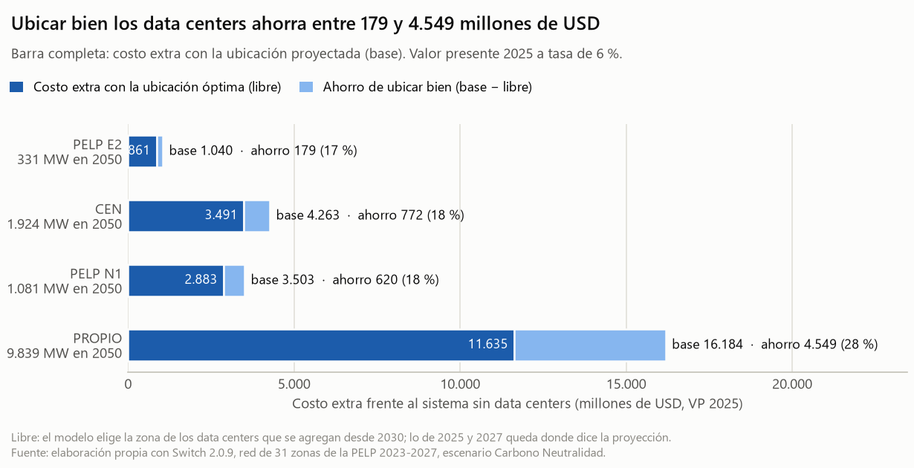
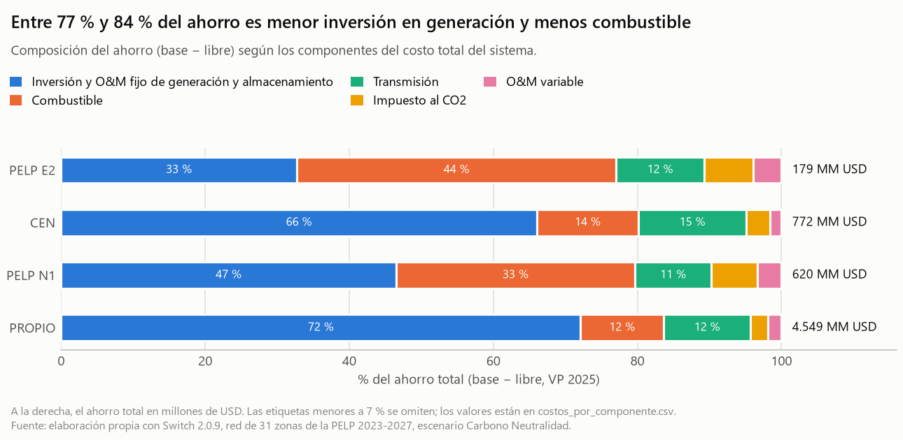
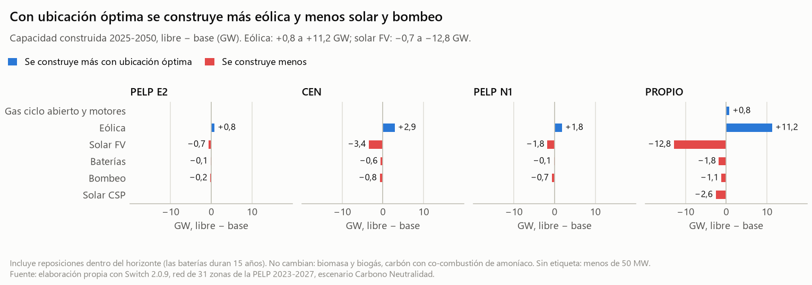
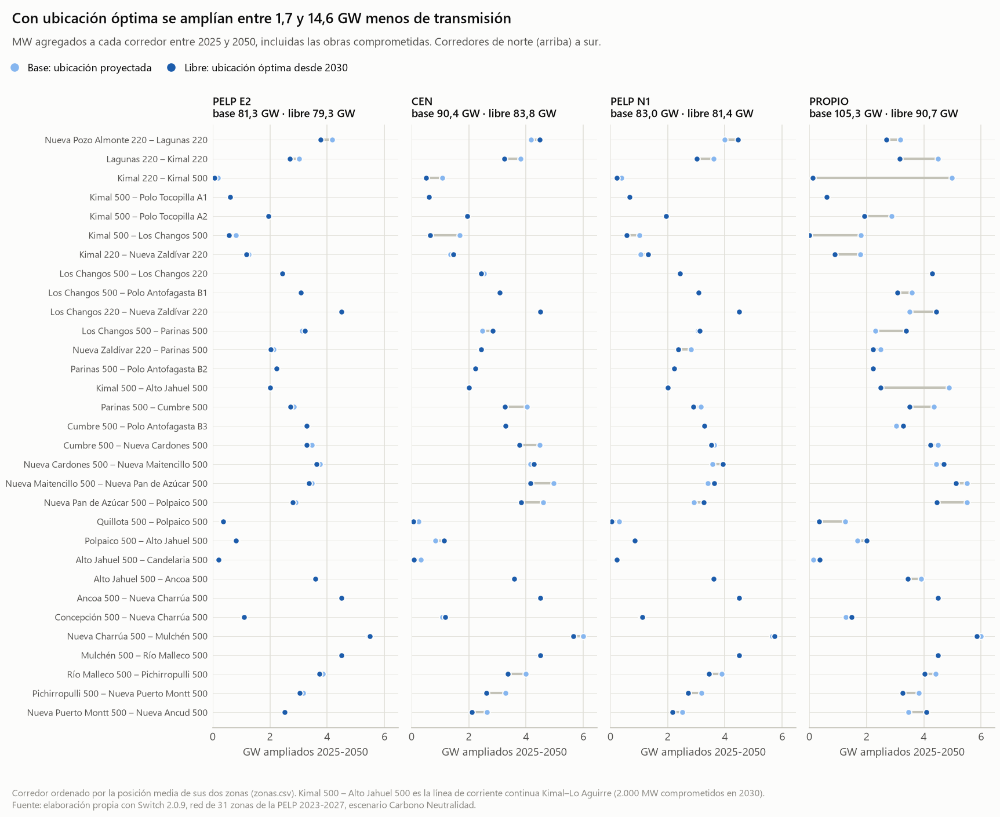
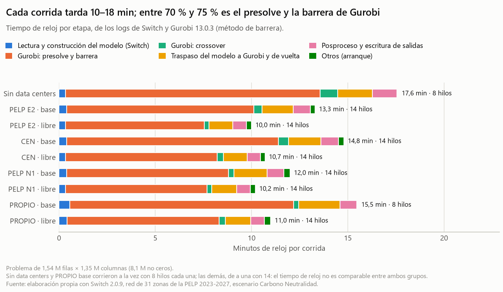

# Análisis de resultados

¿Cuánto se ahorra en la planificación del SEN si el modelo elige dónde van los data centers, frente a ubicarlos donde dicen las proyecciones? Switch 2.0.9 sobre la red de 31 zonas de la PELP 2023–2027 (Carbono Neutralidad), 7 períodos (2025–2054) y 6 días típicos de 24 horas. Costos en valor presente (VP) a 2025 con tasa de 6 %, en millones de USD (MMUSD).

Cada cifra sale de una tabla de `resultados/tablas/`, indicada en cada sección. El modelo está en [FORMULACION.md](FORMULACION.md) y las entradas en [DATOS_Y_SUPUESTOS.md](DATOS_Y_SUPUESTOS.md).

**Casos.** `SIN_DC` es Carbono Neutralidad sin data centers proyectados. Cada uno de los 4 escenarios de data centers se resuelve dos veces:

- **Base:** los data centers en las zonas que indica la proyección.
- **Libre:** los mismos MW en los mismos períodos; el modelo elige la zona de lo que se agrega desde 2030 entre las 26 barras candidatas. Lo de los períodos 2025 y 2027 queda en su zona proyectada y un data center no se traslada.

**Definiciones.** *Costo extra* = costo del caso − costo de `SIN_DC`. *Ahorro* = costo base − costo libre. *Reubicable* = la demanda que se agrega después de 2027, el último período antes de 2030; es la única que el caso libre puede mover.

---

## 1. Resumen de hallazgos

1. **Ubicar bien ahorra 179,1, 772,0, 619,7 y 4.549,0 MMUSD** en PELP E2, CEN, PELP N1 y PROPIO. Es entre el 17,2 % y el 28,1 % del costo extra que agregan los data centers, y entre el 0,41 % y el 7,7 % del costo total del sistema.
2. **El ahorro por MWh reubicado es de 11,9 a 14,9 USD/MWh en los 4 escenarios.** El ahorro relativo sigue a la parte reubicable: PELP E2, PELP N1 y CEN, con el 70 %, el 70 % y el 80 % de su demanda de 2050 reubicable, ahorran entre el 17,2 % y el 18,1 % del costo extra; PROPIO, con el 95 %, ahorra el 28,1 %.
3. **Lo reubicable va sobre todo al sur:** a Nueva Ancud en los 4 escenarios y, en PROPIO, también a Río Malleco, Pichirropulli y Nueva Puerto Montt. En PROPIO, el 33 % de lo reubicable (3,1 GW, todo en el período 2050) va al norte grande: Nueva Pozo Almonte, Nueva Zaldívar, Parinacota y Lagunas. En 2040, sin data centers, abastecer 1 MW plano cuesta 23,0–25,3 USD/MWh en el sur y 37,5–38,1 USD/MWh en las zonas proyectadas. El sur exporta el 64 % de lo que genera, y los corredores Ancoa – Nueva Charrúa y Mulchén – Río Malleco llegan a su tope de ampliación en los 9 casos.
4. **Con la ubicación óptima se construye más eólica (0,8 a 11,2 GW), menos solar FV (0,7 a 12,8 GW), menos baterías y bombeo, y entre 1,7 y 14,6 GW menos de transmisión.** Cada MW de data center pide 4,1–4,3 MW de capacidad nueva en vez de 4,8–5,0. Entre el 77 % y el 84 % del ahorro es menor inversión en generación y almacenamiento y menos combustible.
5. **La expansión eficiente es eólica, solar y almacenamiento.** Sin data centers, en 2050 hay 42,9 GW eólicos, 47,7 GW solares y 16,9 GW de almacenamiento; eólica y solar dan el 92,0 % de la generación y las renovables el 98,3 %. En los 9 casos el modelo decide invertir en eólica, solar FV, baterías y bombeo; PROPIO agrega 2,6 GW de CSP en el caso base y 0,8 GW de gas de ciclo abierto en el libre.
6. **La ubicación óptima reduce las emisiones acumuladas 2025–2054 entre 1,3 y 10,5 Mt CO₂.** Vertimiento solar y eólico en 2050: 5,9–6,3 % en PELP E2, CEN y PELP N1, con o sin reubicación; en PROPIO baja de 8,9 % a 4,8 %.
7. **Cada corrida tarda entre 10,0 y 17,6 minutos;** entre el 72 % y el 80 % es Gurobi (presolve, barrera y crossover).

---

## 2. Escenarios de data centers

Demanda de data centers que se agrega al modelo, en MW medios: carga plana, el mismo valor en todas las horas de cada período. Los data centers que ya operan están dentro de la demanda de la PELP y no se agregan. El origen de cada escenario está en [DATOS_Y_SUPUESTOS.md, sección 8](DATOS_Y_SUPUESTOS.md#8-data-centers).

| Escenario | Fuente | Zonas de la proyección |
|---|---|---|
| PELP E2 | PELP 2028–2032, escenario E2 | Polpaico 500, Quillota 500 |
| CEN | Proyección de Demanda 2026–2046 del Coordinador | Polpaico 500, Quillota 500 |
| PELP N1 | PELP 2028–2032, escenario N1 | Polpaico 500, Quillota 500, Kimal 220 |
| PROPIO | Solicitudes de conexión vigentes ante el Coordinador | Polpaico 500, Alto Jahuel 500, Quillota 500 |

| Escenario | 2025 | 2027 | 2030 | 2035 | 2050 | GWh/año en 2050 | Reubicable en 2050 |
| --- | ---: | ---: | ---: | ---: | ---: | ---: | ---: |
| PELP E2 | 0 | 99 | 225 | 273 | 331 | 2.904 | 232 MW (70 %) |
| CEN | 138 | 382 | 664 | 874 | 1.924 | 16.856 | 1.543 MW (80 %) |
| PELP N1 | 38 | 324 | 750 | 1.023 | 1.081 | 9.474 | 757 MW (70 %) |
| PROPIO | 20 | 460 | 2.004 | 3.034 | 9.839 | 86.194 | 9.333 MW (95 %) |

Tablas: `escenarios_dc.csv`, `escenarios_dc_resumen.csv`. Desde 2031, la capacidad de CEN crece 5 % anual. Desde 2033, la demanda total de data centers de PROPIO crece 8 % anual, y ese crecimiento es reubicable. PELP E2 y PELP N1 siguen la trayectoria de la PELP. PROPIO incluye carga fija (llenado de campus ya conectados en Polpaico y Alto Jahuel), que no se mueve en ningún caso: 12 MW medios en 2025, 69 en 2027 y 115 desde 2030.


Lo de los períodos 2025 y 2027 queda comprometido en las zonas proyectadas: 382 de los 1.924 MW de 2050 en CEN, 99 de 331 en PELP E2, 324 de 1.081 en PELP N1 y 507 de 9.839 en PROPIO (con la carga fija). PELP E2 y PELP N1 tienen la menor parte reubicable, el 70 %; CEN, el 80 %, y PROPIO, el 95 %.

---

## 3. Costo extra y ahorro

El sistema sin data centers cuesta **42.618,8 MMUSD**.

| Escenario | Costo base | Costo libre | Extra base | Extra libre | Ahorro | Ahorro / extra | Ahorro / total |
| --- | ---: | ---: | ---: | ---: | ---: | ---: | ---: |
| PELP E2 | 43.658,7 | 43.479,5 | 1.039,9 | 860,8 | 179,1 | 17,2 % | 0,41 % |
| CEN | 46.882,2 | 46.110,3 | 4.263,4 | 3.491,5 | 772,0 | 18,1 % | 1,65 % |
| PELP N1 | 46.121,6 | 45.502,0 | 3.502,8 | 2.883,2 | 619,7 | 17,7 % | 1,34 % |
| PROPIO | 58.802,9 | 54.253,9 | 16.184,1 | 11.635,1 | 4.549,0 | 28,1 % | 7,74 % |



Por MWh, con la energía también en VP 2025:

| Escenario | Energía DC (TWh VP) | Extra base (USD/MWh) | Extra libre (USD/MWh) | Energía reubicable (TWh VP) | Ahorro por MWh DC | Ahorro por MWh reubicado |
| --- | ---: | ---: | ---: | ---: | ---: | ---: |
| PELP E2 | 24,8 | 41,9 | 34,7 | 14,5 | 7,2 | 12,4 |
| CEN | 97,7 | 43,6 | 35,7 | 55,6 | 7,9 | 13,9 |
| PELP N1 | 86,7 | 40,4 | 33,3 | 52,2 | 7,2 | 11,9 |
| PROPIO | 358,3 | 45,2 | 32,5 | 306,0 | 12,7 | 14,9 |

Tablas: `costos.csv`, `escenarios_dc_resumen.csv`.


- **Abastecer un data center cuesta al sistema 40,4–45,2 USD/MWh con la ubicación proyectada** y 32,5–35,7 USD/MWh con la óptima.
- **El ahorro escala con lo que se puede mover.** Por MWh reubicado es de 11,9 a 14,9 USD/MWh en los 4 escenarios, aunque su demanda de 2050 va de 331 a 9.839 MW. Las diferencias en el ahorro relativo vienen de la parte comprometida en 2025 y 2027: con el 70–80 % reubicable, PELP E2, PELP N1 y CEN ahorran el 17,2–18,1 % del costo extra; PROPIO, con el 95 %, el 28,1 %.
- **Es también un umbral.** Ubicar un data center en la zona elegida conviene al sistema mientras lo que cuesta llevarlo allá (conexión, terreno, fibra, latencia), que el modelo no incluye, sea menor que unos 12 a 15 USD por MWh reubicado.

---

## 4. De dónde sale el ahorro

Ahorro (base − libre) por componente del costo total, en MMUSD y en % del ahorro:

| Componente | PELP E2 | CEN | PELP N1 | PROPIO |
| --- | ---: | ---: | ---: | ---: |
| Inversión y O&M fijo de generación y almacenamiento | 58,6 (32,7 %) | 509,8 (66,0 %) | 288,2 (46,5 %) | 3.280,7 (72,1 %) |
| Combustible | 79,4 (44,3 %) | 108,9 (14,1 %) | 205,6 (33,2 %) | 525,0 (11,5 %) |
| Transmisión (inversión y O&M fijo) | 21,8 (12,2 %) | 115,6 (15,0 %) | 65,5 (10,6 %) | 547,9 (12,0 %) |
| Impuesto al CO₂ | 12,3 (6,9 %) | 25,3 (3,3 %) | 39,9 (6,4 %) | 112,0 (2,5 %) |
| O&M variable | 7,0 (3,9 %) | 12,4 (1,6 %) | 20,5 (3,3 %) | 83,5 (1,8 %) |
| **Total** | **179,1** | **772,0** | **619,7** | **4.549,0** |

Tabla: `costos_por_componente.csv` (columnas `base - libre`). Energía no suministrada: 0 en los 9 casos.



- **Inversión en generación y almacenamiento:** 72,1 % del ahorro en PROPIO y 32,7 % en PELP E2. Con la ubicación proyectada es entre el 70,7 % y el 83,6 % del costo extra.
- **Combustible:** 11,5 % en PROPIO y 44,3 % en PELP E2.
- **Transmisión:** entre 10,6 % y 15,0 % del ahorro; su costo extra con la ubicación proyectada es entre el 2,2 % y el 4,6 % del costo extra total.

---

## 5. Expansión eficiente

### 5.1 Matriz de capacidad y generación

Capacidad instalada sin data centers, en GW, y participación en la generación de 2050:

| Familia (GW) | 2025 | 2027 | 2030 | 2035 | 2040 | 2045 | 2050 | Generación 2050 |
| --- | ---: | ---: | ---: | ---: | ---: | ---: | ---: | ---: |
| Hidro | 7,9 | 7,9 | 7,9 | 7,9 | 7,9 | 7,9 | 7,9 | 5,5 % |
| Gas | 4,6 | 4,9 | 4,9 | 4,9 | 4,9 | 4,9 | 4,9 | 1,3 % |
| Eólica | 9,0 | 9,6 | 17,7 | 29,8 | 34,3 | 37,7 | 42,9 | 49,3 % |
| Solar | 10,4 | 10,9 | 10,9 | 17,6 | 17,6 | 33,2 | 47,7 | 42,7 % |
| Almacenamiento | 1,0 | 4,0 | 4,3 | 5,8 | 6,2 | 11,1 | 16,9 | – |
| Biomasa y otras | 0,8 | 1,0 | 1,0 | 1,0 | 1,0 | 1,0 | 1,0 | 1,0 % |
| Carbón | 3,7 | 1,6 | 1,6 | 0,7 | 0,7 | 0,7 | 0,7 | 0,2 % |
| Diésel | 3,3 | 3,3 | 3,3 | 3,3 | 3,3 | 3,3 | 3,3 | 0,1 % |
| **Total** | **40,7** | **43,2** | **51,6** | **71,0** | **76,0** | **99,8** | **125,3** | 100 % |

Tabla: `matriz_generacion.csv` (por grupo de tecnología, en los 9 casos). Solar incluye la CSP; biomasa y otras incluye biogás, geotermia y cogeneración; el carbón que queda desde 2035 es co-combustión con amoníaco. La participación excluye la descarga del almacenamiento.

- La generación sin data centers pasa de 99.224 GWh en 2025 a 314.537 GWh en 2050.
- La eólica es la primera fuente desde 2025 (30,9 % ese año) y la solar crece sobre todo en 2045 y 2050.
- En 2050 el almacenamiento tiene 40,5 GWh en baterías y 75,5 GWh en bombeo.


Capacidad adicional en 2050 frente a `SIN_DC`, en GW. Las demás tecnologías no cambian, salvo 0,76 GW de gas de ciclo abierto en PROPIO libre, que están en su total:

| Caso | Eólica | Solar | Almacenamiento | Total | MW por MW de DC |
| --- | ---: | ---: | ---: | ---: | ---: |
| PELP E2 · base | −0,02 | 1,16 | 0,44 | 1,58 | 4,8 |
| PELP E2 · libre | 0,75 | 0,49 | 0,10 | 1,35 | 4,1 |
| CEN · base | 1,53 | 6,05 | 2,12 | 9,70 | 5,0 |
| CEN · libre | 4,40 | 2,64 | 0,80 | 7,84 | 4,1 |
| PELP N1 · base | 0,69 | 3,31 | 1,22 | 5,23 | 4,8 |
| PELP N1 · libre | 2,49 | 1,55 | 0,44 | 4,48 | 4,1 |
| PROPIO · base | 2,47 | 35,29 | 10,87 | 48,64 | 4,9 |
| PROPIO · libre | 13,72 | 19,93 | 7,93 | 42,34 | 4,3 |


Con la ubicación proyectada, los data centers se abastecen sobre todo con solar y almacenamiento. Con la óptima, el almacenamiento baja en los 4 escenarios y la eólica nueva, sobre todo en el centro-sur y el sur (sección 5.4 y `expansion_por_zona.csv`), pasa a ser la mayor parte en PELP E2, CEN y PELP N1; en PROPIO sube de 2,5 a 13,7 GW.

### 5.2 Inversiones nuevas por tecnología

MW construidos entre 2025 y 2050 sin data centers. Comprometidos son las obras fijas en las entradas; desde el inicio en 2025 no incluyen ninguna inversión decidida por AMEBA, y las BESS «ley» (2.000 MW, costo 0, desde 2027) son candidatas:

| Grupo | MW construidos | Comprometidos | Decididos por el modelo | MWh de almacenamiento |
| --- | ---: | ---: | ---: | ---: |
| Baterías | 10.708 | 1.019 | 9.689 | 44.866 |
| Biomasa y biogás | 200 | 200 | 0 | – |
| Bombeo | 7.232 | 0 | 7.232 | 75.467 |
| Carbón con co-combustión de amoníaco | 2.379 | 2.379 | 0 | – |
| Eólica | 39.009 | 0 | 39.009 | – |
| Gas ciclo abierto y motores | 300 | 300 | 0 | – |
| Solar FV | 42.461 | 0 | 42.461 | – |

Los MW construidos incluyen reposiciones dentro del horizonte (las baterías nuevas duran 15 años). Los topes anuales de AMEBA a la FV y la eólica nuevas, sumados en los años de cada período, no restringen ([DATOS_Y_SUPUESTOS.md](DATOS_Y_SUPUESTOS.md)): sin data centers, el período 2025 construye 2.609 MW de FV y 5.062 MW eólicos. En los 9 casos, el modelo decide invertir en eólica, solar FV, baterías y bombeo; en PROPIO agrega 2.563 MW de CSP en el caso base y 760 MW de gas de ciclo abierto en el libre.

Diferencia de MW construidos 2025–2050, libre − base:

| Grupo | PELP E2 | CEN | PELP N1 | PROPIO |
| --- | ---: | ---: | ---: | ---: |
| Eólica | +769 | +2.876 | +1.802 | +11.249 |
| Solar FV | −681 | −3.448 | −1.767 | −12.831 |
| Baterías | −121 | −556 | −109 | −1.796 |
| Bombeo | −219 | −773 | −678 | −1.147 |

En PROPIO cambian además la CSP (−2.563 MW) y el gas de ciclo abierto (+760 MW). Tablas: `inversiones_por_tecnologia.csv`, `inversiones_libre_menos_base.csv` (con la diferencia por período).



La ubicación de los períodos 2025 y 2027 es la misma en ambos modos, pero la inversión de esos períodos puede cambiar porque el caso libre anticipa dónde irá la carga desde 2030: en 2025–2027 construye entre 29 (PELP E2) y 646 MW (PROPIO) menos de solar FV.

### 5.3 Transmisión

MW agregados a los corredores entre 2025 y 2050 (incluye las obras comprometidas) e inversión overnight, sin descontar, en MMUSD:

| Escenario | Ampliado base (GW) | Ampliado libre (GW) | Libre − base (GW) | Inversión base | Inversión libre | Libre − base |
| --- | ---: | ---: | ---: | ---: | ---: | ---: |
| PELP E2 | 81,3 | 79,3 | −2,0 | 5.910 | 5.794 | −116 |
| CEN | 90,4 | 83,8 | −6,6 | 6.530 | 6.050 | −480 |
| PELP N1 | 83,0 | 81,4 | −1,7 | 6.021 | 5.881 | −140 |
| PROPIO | 105,3 | 90,7 | −14,6 | 8.959 | 6.868 | −2.092 |

Sin data centers se amplían 77,9 GW. Las obras comprometidas son 2.660 MW: el HVDC Kimal–Lo Aguirre (2.000 MW, corredor Kimal 500 – Alto Jahuel 500) y Río Malleco–Pichirropulli (660 MW), ambas en 2030. Los 2.672 MW que AMEBA construyó hasta 2025 no entran como dato: los decide el modelo.

| Escenario | Mayores reducciones (MW) | Mayores aumentos (MW) |
| --- | --- | --- |
| PELP E2 | Nueva Pozo Almonte 220 – Lagunas 220 (−395), Lagunas 220 – Kimal 220 (−308), Kimal 500 – Los Changos 500 (−232) | Los Changos 500 – Parinas 500 (+115), Concepción 500 – Nueva Charrúa 500 (+30) |
| CEN | Kimal 500 – Los Changos 500 (−1.014), Nueva Maitencillo 500 – Nueva Pan de Azúcar 500 (−811), Parinas 500 – Cumbre 500 (−767) | Los Changos 500 – Parinas 500 (+358), Nueva Pozo Almonte 220 – Lagunas 220 (+307), Polpaico 500 – Alto Jahuel 500 (+302) |
| PELP N1 | Lagunas 220 – Kimal 220 (−577), Pichirropulli 500 – Nueva Puerto Montt 500 (−475), Nueva Zaldívar 220 – Parinas 500 (−453) | Nueva Pozo Almonte 220 – Lagunas 220 (+457), Nueva Cardones 500 – Nueva Maitencillo 500 (+375), Nueva Pan de Azúcar 500 – Polpaico 500 (+334) |
| PROPIO | Kimal 220 – Kimal 500 (−4.848), Kimal 500 – Alto Jahuel 500 (−2.395), Kimal 500 – Los Changos 500 (−1.807) | Los Changos 500 – Parinas 500 (+1.084), Los Changos 220 – Nueva Zaldívar 220 (+940), Nueva Puerto Montt 500 – Nueva Ancud 500 (+627) |

Tablas: `transmision_ampliaciones.csv` (por corredor y período), `transmision_libre_menos_base.csv` (totales, tope y diferencia por período).



- **Menos transmisión, sobre todo en el norte.** Con la carga reubicada, ya no hay que llevar tanta energía solar del norte grande al centro: las mayores reducciones están en los corredores entre Nueva Pozo Almonte, Lagunas, Kimal, Los Changos y Parinas, y en PROPIO también en el enlace Kimal 500 – Alto Jahuel 500. Los aumentos son menores y puntuales.
- **2 corredores llegan a su tope de ampliación en los 9 casos:** Ancoa 500 – Nueva Charrúa 500 y Mulchén 500 – Río Malleco 500. Los Changos 220 – Nueva Zaldívar 220 llega a su tope en los 7 casos que no son PROPIO. En PROPIO base llegan al tope además Lagunas 220 – Kimal 220, Los Changos 500 – Los Changos 220, Cumbre 500 – Nueva Cardones 500, Nueva Maitencillo 500 – Nueva Pan de Azúcar 500, Nueva Pan de Azúcar 500 – Polpaico 500 y Nueva Charrúa 500 – Mulchén 500.
- **En dinero:** la inversión overnight en transmisión baja entre 116 y 2.092 MMUSD; en VP, la transmisión explica entre 21,8 y 547,9 MMUSD del ahorro (sección 4).

### 5.4 Expansión por zona

MW nuevos 2025–2050 (generación y almacenamiento) por macrozona sin data centers, en GW, y diferencia libre − base:

| Macrozona | Sin DC (GW nuevos) | PELP E2 | CEN | PELP N1 | PROPIO |
| --- | ---: | ---: | ---: | ---: | ---: |
| Norte Grande | 55,6 | −1,27 | −4,50 | −3,74 | −8,63 |
| Norte Chico | 17,1 | +0,26 | −0,57 | +1,16 | −4,62 |
| Centro | 5,8 | −0,02 | +0,30 | +0,03 | −7,26 |
| Centro-Sur | 11,4 | +0,60 | +1,75 | +1,41 | +5,66 |
| Sur | 12,4 | +0,17 | +1,13 | +0,39 | +8,53 |

Tablas: `expansion_por_zona.csv` (por zona, período y tecnología), `expansion_zona_libre_menos_base.csv` (por zona), `expansion_por_macrozona.csv`.

- **El norte grande concentra la expansión:** 55,6 de los 102,3 GW nuevos sin data centers.
- **Con la ubicación óptima, la expansión se mueve del norte grande al centro-sur y al sur** en los 4 escenarios. Capacidad nueva del sur: 12,4 GW sin data centers y 24,0 GW en PROPIO libre.
- **Zonas que más cambian, libre − base.** En PROPIO, suben Nueva Ancud (+6,1 GW), Parinacota (+2,8 GW) y Concepción (+2,1 GW), y bajan Polpaico (−7,7 GW), Nueva Pan de Azúcar (−3,9 GW) y Kimal 220 (−3,5 GW).

**Orden norte → sur.** Las entradas no traen coordenadas. Cada zona es una subestación del SEN, y `zonas.csv` le asigna la latitud aproximada de esa subestación (redondeada a 0,1°), su región y una macrozona: Norte Grande (Arica a Antofagasta), Norte Chico (Atacama y Coquimbo), Centro (Valparaíso, Metropolitana y O'Higgins), Centro-Sur (Maule a Biobío) y Sur (Araucanía a Los Lagos). Los 5 polos PDGE se ubican junto a la subestación a la que se conectan en `transmission_lines.csv`. Cada corredor se ordena por la posición media de sus dos zonas.

---

## 6. Ubicación y precios

Data centers por zona en 2050, en MW medios:

| Zona | PELP E2 base | PELP E2 libre | CEN base | CEN libre | PELP N1 base | PELP N1 libre | PROPIO base | PROPIO libre |
| --- | ---: | ---: | ---: | ---: | ---: | ---: | ---: | ---: |
| Parinacota 220 (18,5° S) |  |  |  |  |  |  |  | 234 |
| Nueva Pozo Almonte 220 (20,3° S) |  |  |  |  |  |  |  | 2.024 |
| Lagunas 220 (21,0° S) |  |  |  |  |  |  |  | 22 |
| Kimal 220 (22,3° S) |  |  |  |  | 750 | 225 |  |  |
| Nueva Zaldívar 220 (24,3° S) |  |  |  |  |  |  |  | 805 |
| Quillota 500 (32,9° S) | 50 | 15 | 212 | 39 | 50 | 15 | 2.041 | 100 |
| Polpaico 500 (33,1° S) | 282 | 84 | 1.712 | 343 | 282 | 84 | 4.299 | 310 |
| Alto Jahuel 500 (33,7° S) |  |  |  |  |  |  | 3.499 | 96 |
| Río Malleco 500 (38,0° S) |  |  |  |  |  |  |  | 750 |
| Pichirropulli 500 (40,0° S) |  |  |  |  |  |  |  | 620 |
| Nueva Puerto Montt 500 (41,4° S) |  |  |  |  |  |  |  | 354 |
| Nueva Ancud 500 (41,9° S) |  | 232 |  | 1.543 |  | 757 |  | 4.524 |

Tabla: `ubicacion_dc.csv`. En el caso libre, lo que queda en Polpaico, Quillota, Alto Jahuel y Kimal es lo de los períodos 2025 y 2027 (más la carga fija de PROPIO). En PELP E2, CEN y PELP N1, el 100 % de lo reubicable va a Nueva Ancud. En PROPIO, el 67 % va al sur (Nueva Ancud, Río Malleco, Pichirropulli y Nueva Puerto Montt) y el 33 % al norte grande (Nueva Pozo Almonte, Nueva Zaldívar, Parinacota y Lagunas); la carga del norte grande llega toda en el período 2050.


**Por qué el sur.** El precio de una carga plana es el promedio horario del costo marginal de la zona, el dual de su balance. Como el modelo es de expansión, incluye la inversión que exige abastecer 1 MW más. Sin data centers, en USD/MWh:

| Macrozona | 2025 | 2027 | 2030 | 2035 | 2040 | 2045 | 2050 |
| --- | ---: | ---: | ---: | ---: | ---: | ---: | ---: |
| Norte Grande | 47,4–47,9 | 51,4–52,8 | 28,3–33,6 | 39,0–40,8 | 37,0–37,9 | 39,0–39,8 | 35,5–36,4 |
| Norte Chico | 56,4–62,3 | 67,5–71,4 | 33,1 | 40,3–41,3 | 37,3–38,1 | 39,8–41,1 | 36,3–37,6 |
| Centro | 67,4–68,1 | 76,4–78,6 | 33,1 | 41,3 | 37,5–38,1 | 41,8–42,2 | 38,3–38,6 |
| Centro-Sur | 68,1–68,8 | 78,6 | 27,0–32,1 | 32,8–40,3 | 25,5–36,1 | 25,4–41,3 | 30,8–37,3 |
| Sur | 68,1 | 78,6 | 27,0 | 30,4–32,6 | 23,0–25,3 | 22,6–25,2 | 27,6–29,5 |

Tabla: `precios_zonales.csv` (por zona, período y caso).


Balance de energía por macrozona sin data centers, en 2040:

| Macrozona | Generación neta (TWh) | Demanda (TWh) | Exportación neta (TWh) | Exporta (% de su generación) |
| --- | ---: | ---: | ---: | ---: |
| Norte Grande | 79,5 | 67,5 | 12,0 | 15 % |
| Norte Chico | 17,5 | 19,3 | −1,8 | – |
| Centro | 11,4 | 61,9 | −50,5 | – |
| Centro-Sur | 45,8 | 23,2 | 22,5 | 49 % |
| Sur | 27,7 | 9,9 | 17,7 | 64 % |

Tabla: `balance_por_macrozona.csv`. Generación neta = inyección − carga del almacenamiento.

- **El sur tiene eólica de sobra y no puede exportar más.** Exporta el 64 % de lo que genera, y los corredores hacia el centro (Mulchén 500 – Río Malleco 500 y Ancoa 500 – Nueva Charrúa 500) están en su tope de ampliación. El precio salta de 26,0 USD/MWh en Nueva Charrúa a 36,1 USD/MWh en Ancoa (2040), a ambos lados de ese tope.
- **Un data center en el sur consume esa energía donde se produce:** no necesita la solar y el almacenamiento del norte ni la transmisión hacia el centro. En PROPIO, la exportación neta del sur en 2040 pasa de 25,2 TWh (base) a 1,6 TWh (libre).
- **Nueva Ancud es la zona más barata** (23,0 USD/MWh en 2040). En PROPIO, los 6,2 GW que llegan al sur hasta 2045 suben su precio: en 2050 el sur y el norte grande quedan en 39,1–40,3 USD/MWh, frente a 41,4–42,6 en el centro, y lo que se agrega ese período (3,2 GW) va casi todo al norte grande.

Precio medio de una carga plana en las zonas donde están los data centers, ponderado por sus MW, en USD/MWh:

| Escenario | Base 2030 | Libre 2030 | Base 2040 | Libre 2040 | Base 2050 | Libre 2050 |
| --- | ---: | ---: | ---: | ---: | ---: | ---: |
| PELP E2 | 34,6 | 30,6 | 38,8 | 28,4 | 39,2 | 31,2 |
| CEN | 36,4 | 32,7 | 40,9 | 29,0 | 40,9 | 31,5 |
| PELP N1 | 36,7 | 31,7 | 38,9 | 28,2 | 38,2 | 31,2 |
| PROPIO | 45,6 | 33,8 | 48,1 | 29,5 | 49,5 | 39,5 |

Tabla: `precio_dc.csv` (incluye el precio de las mismas zonas sin data centers).

---

## 7. Emisiones y vertimiento

| Caso | Emisiones 2025–2054 (Mt CO₂) | 2025 (Mt/año) | 2027 (Mt/año) | 2030 (Mt/año) | 2050 (Mt/año) | Renovable 2050 | Vertimiento solar y eólico 2050 | Vertimiento acumulado (TWh) |
| --- | ---: | ---: | ---: | ---: | ---: | ---: | ---: | ---: |
| Sin data centers | 128,2 | 12,22 | 12,50 | 2,31 | 2,35 | 98,3 % | 5,9 % | 227,4 |
| PELP E2 · base | 131,8 | 12,10 | 12,82 | 2,60 | 2,35 | 98,3 % | 5,9 % | 237,7 |
| PELP E2 · libre | 130,5 | 12,11 | 12,85 | 2,45 | 2,35 | 98,3 % | 6,0 % | 236,8 |
| CEN · base | 140,5 | 12,52 | 14,01 | 2,91 | 2,26 | 98,5 % | 6,3 % | 269,7 |
| CEN · libre | 138,3 | 12,54 | 14,10 | 2,77 | 2,34 | 98,5 % | 6,2 % | 259,6 |
| PELP N1 · base | 138,3 | 12,17 | 13,33 | 3,04 | 2,31 | 98,4 % | 6,0 % | 255,7 |
| PELP N1 · libre | 134,1 | 12,17 | 13,42 | 2,67 | 2,30 | 98,4 % | 6,2 % | 258,1 |
| PROPIO · base | 155,7 | 11,84 | 13,45 | 4,13 | 2,83 | 98,5 % | 8,9 % | 443,8 |
| PROPIO · libre | 145,2 | 11,89 | 13,80 | 3,35 | 3,31 | 98,4 % | 4,8 % | 270,6 |

Tablas: `emisiones_vertimiento.csv` (por período), `resumen_casos.csv`. Emisiones acumuladas = emisiones anuales × años de cada período. Vertimiento = energía disponible (capacidad × disponibilidad × factor de planta horario, el mismo límite de despacho de Switch) − energía despachada.

- **Emisiones.** Los períodos 2025 y 2027 emiten 11,8–14,1 Mt/año y aportan entre el 41 % y el 49 % de las acumuladas; desde 2030 quedan entre 2,3 y 4,1 Mt/año. La ubicación óptima cambia las acumuladas en −1,3 (PELP E2), −2,2 (CEN), −4,2 (PELP N1) y −10,5 Mt (PROPIO). En 2025 y 2027, el caso libre emite algo más que el base, hasta 0,35 Mt/año en PROPIO 2027, porque en esos períodos construye menos solar FV (sección 5.2).
- **CEN frente a PELP N1:** 140,5 frente a 138,3 Mt con ubicación proyectada; en 2025–2029, 13,4 frente a 12,9 Mt/año, por la mayor demanda comprometida de CEN (382 frente a 324 MW en 2027).
- **Vertimiento.** El de solar y eólica es de 5,9–8,9 % en 2050; efecto de la ubicación: cambia a lo más 0,3 puntos en PELP E2, CEN y PELP N1, y en PROPIO baja de 8,9 % a 4,8 % (de 444 a 271 TWh acumulados). El vertimiento hídrico no supera 63 GWh/año.

---

## 8. Tiempos de cómputo

| Caso | Hilos | Lectura y construcción (s) | Iteraciones de barrera | Barrera (s) | Crossover (s) | Solver según Switch (s) | Posproceso (s) | Reloj (min) |
| --- | ---: | ---: | ---: | ---: | ---: | ---: | ---: | ---: |
| Sin data centers | 8 | 20,6 | 164 | 791,8 | 54,6 | 955,6 | 76,9 | 17,6 |
| PELP E2 · base | 14 | 23,4 | 171 | 583,4 | 24,8 | 706,1 | 54,0 | 13,3 |
| PELP E2 · libre | 14 | 20,0 | 156 | 431,7 | 15,1 | 521,6 | 42,5 | 10,0 |
| CEN · base | 14 | 24,2 | 169 | 658,6 | 31,3 | 792,5 | 54,8 | 14,8 |
| CEN · libre | 14 | 20,0 | 174 | 471,9 | 19,2 | 566,2 | 42,0 | 10,7 |
| PELP N1 · base | 14 | 24,2 | 131 | 502,9 | 17,4 | 624,0 | 52,5 | 12,0 |
| PELP N1 · libre | 14 | 19,9 | 156 | 440,7 | 14,9 | 533,4 | 42,8 | 10,2 |
| PROPIO · base | 8 | 33,4 | 124 | 696,3 | 16,0 | 842,0 | 52,6 | 15,5 |
| PROPIO · libre | 14 | 24,6 | 147 | 474,1 | 18,5 | 572,3 | 43,5 | 11,0 |

Tablas: `tiempos_computo.csv`, `entorno_computo.csv`.



- **Tamaño.** Cada caso es un programa lineal de 1.542.353 restricciones (1.542.230 en modo libre), 1.346.239 variables y 8,07 millones de coeficientes; tras el presolve quedan unas 890 mil filas y 996 mil columnas.
- **Equipo y solver.** Intel Core Ultra 9 185H (16 núcleos físicos, 22 lógicos), Gurobi 13.0.3 con barrera (`Method=2`).
- **Dónde se va el tiempo.** Gurobi (presolve, barrera y crossover) es entre el 72 % y el 80 % del tiempo de reloj. Pasar el modelo de Pyomo a Gurobi y leer la solución toma otros 74 a 129 s.
- **Las 9 corridas suman 115 minutos.** `SIN_DC` y PROPIO base corrieron a la vez, con 8 hilos cada una; las otras 7, de a una y con 14 hilos. El tiempo de reloj no es comparable entre ambos grupos.
- **Memoria.** Con 7 períodos, el ordenamiento de la barrera de Gurobi llega a unos 20–60 GB por corrida. En un equipo de 63 GB conviene correr un caso a la vez.

---

## 9. Limitaciones

Las del modelo y los datos están en [DATOS_Y_SUPUESTOS.md, sección 9](DATOS_Y_SUPUESTOS.md#9-limitaciones). Las que más pesan en estos resultados:

- **Sin costos de ubicación de los data centers.** El caso libre no paga conexión, terreno, fibra ni latencia, ni tiene tope por zona. El ahorro es el del sistema eléctrico; los 12 a 15 USD por MWh reubicado son el máximo que esos costos podrían sumar para que reubicar siga conviniendo.
- **El sur barato depende de los topes de transmisión** (Ancoa 500 – Nueva Charrúa 500 y Mulchén 500 – Río Malleco 500, en su tope en los 9 casos), que vienen de los candidatos de la PELP. Si esos corredores pudieran ampliarse más, la diferencia de precio entre el sur y el centro, y con ella el ahorro, sería menor.
- **Modelo de transporte.** Sin leyes de Kirchhoff ni pérdidas, abastecer el centro desde el norte sale más barato de lo que es: por este lado, el ahorro está subestimado.
- **Una sola zona de destino en PELP E2, CEN y PELP N1.** Nueva Ancud gana a Nueva Puerto Montt por 0,1–1,6 % del costo acumulado ([VALIDACION.md](VALIDACION.md#6-resultados)): el resultado se lee como una región, no como una subestación. En PROPIO, la carga de 2050 se reparte entre el sur y el norte grande, con precios casi iguales.
- **Previsión perfecta y carga plana.** El caso libre elige la zona con los precios futuros que el propio modelo produce, y los data centers no tienen flexibilidad horaria.
- **6 días típicos por período** y operación sin compromiso de unidades.
- **Salidas de AMEBA como entrada.** La energía hidro por día típico, el perfil del consumo de H₂/NH₃ y el factor 1,031 de la demanda siguen saliendo de la solución de AMEBA.
- **Latitudes aproximadas.** El orden norte → sur de `zonas.csv` es una aproximación propia; cambiar un decimal no altera el orden por macrozona.
- **PROPIO con carga fija** no tiene la verificación independiente de costos que tuvieron los otros escenarios ([VALIDACION.md, sección 8](VALIDACION.md#8-lo-que-no-está-validado)).

---

## Reproducción

Desde la raíz del repositorio, con las salidas ya incluidas (no hace falta volver a resolver):

```bash
python scripts/resultados.py
python scripts/tiempos_computo.py
python scripts/analisis.py
python scripts/graficos.py
```

`graficos.py` lee las tablas de los tres primeros, incluida `tiempos_computo.csv`. Las figuras quedan en `resultados/figuras/` en PNG (150 dpi) y SVG.
